<p align="center">
  <picture>
    <source media="(prefers-color-scheme: dark)" srcset="docs/brand/banner-dark.png">
    <source media="(prefers-color-scheme: light)" srcset="docs/brand/banner-light.png">
    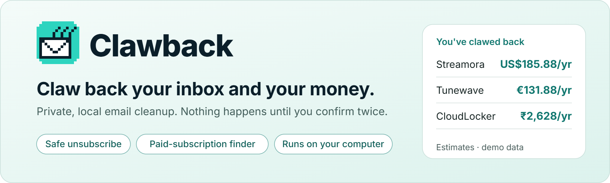
  </picture>
</p>

<p align="center">
  <a href="https://github.com/sainisourabh1-oss/clawback/actions/workflows/ci.yml"></a>
  <a href="https://pypi.org/project/clawback/"></a>
  
  
  
  <a href="LICENSE"></a>
</p>

<p align="center"><b>Unsubscribe safely, find the subscriptions you pay for, and see what you save. On your own computer.</b></p>

**Clawback** is an email cleanup tool that runs on your own computer; it is free and open source (MIT).
It finds the newsletters, marketing and spam-like senders filling your inbox and the paid subscriptions
hiding in your receipts, unsubscribes or blocks them **only after you confirm twice**, and keeps an
honest tally of what you have saved, in every currency you pay in.

<p align="center">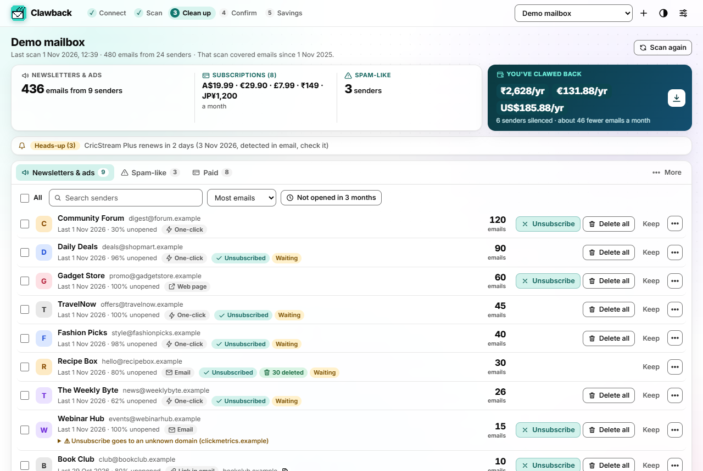</p>

<p align="center">
  <a href="#quick-start">Quick start</a> ·
  <a href="#features">Features</a> ·
  <a href="#ways-to-connect-and-how-well-each-is-tested">Ways to connect</a> ·
  <a href="#safety-the-double-confirmation">Safety</a> ·
  <a href="#privacy">Privacy</a> ·
  <a href="#faq">FAQ</a> ·
  <a href="#contributing">Contributing</a>
</p>

## Why Clawback

- **Local and private.** A small web app served on `127.0.0.1` only. No account, no server, no
  analytics, no AI service. Your mail is read on your machine and never uploaded.
- **Zero setup option.** Import a Google Takeout export (or any `.mbox` / `.eml` folder). No Google
  Cloud project, no password.
- **Simple and safe.** Each sender is one row with its email count and three buttons: Unsubscribe,
  Delete all, Keep (Unsubscribe + delete all is one more click away). Tick several to act on them
  together. Nothing happens on the first click: the buttons turn, in the same place, into
  **Yes, delete 120 emails** and **Cancel**, with one or two plain lines on what will happen. Only
  that Yes does it. No pop-ups, nothing to type. Deleting needs a Google or Microsoft sign-in (see
  [what each connection can do](#ways-to-connect-and-how-well-each-is-tested)); deleted mail goes
  to Trash, never deleted for good, with Undo right after. Every action is logged locally.
- **Proof it worked.** After you unsubscribe, Clawback checks whether the sender keeps mailing you
  and shows *Honoured*, *Waiting* or *Still sending*, with an evidence timeline, and offers a
  confirmed escalation (Gmail filter + report as spam) for senders that ignore you.
- **Money, not just mail.** Finds paid subscriptions in receipts and in bank alerts (UPI AutoPay,
  card e-mandates, SEPA and UK Direct Debit notices, card recurring-charge alerts), opens verified
  cancellation pages, and shows savings per currency. Currencies are never added together.
- **Global, with regional modules.** Ten most-traded currencies plus INR and more; India, EU/UK,
  US and card-network modules; contributors can add regions.

## Quick start

You need Python 3.10 or newer. Install it from [PyPI](https://pypi.org/project/clawback/):

```bash
python -m venv clawback-env
. clawback-env/bin/activate        # Windows: clawback-env\Scripts\activate
pip install "clawback[gmail]"
clawback
```

The `[gmail]` extra adds Google's client libraries for *Connect Gmail*; leave it out
(`pip install clawback`) if you only import Takeout or use IMAP. To run the latest code from GitHub
instead: `pip install "clawback[gmail] @ git+https://github.com/sainisourabh1-oss/clawback"`.

`clawback` opens the app in your browser (`clawback ui --no-browser` prints the address instead). Then
pick one:

1. **Try the demo**: a fictional mailbox (all senders use the reserved `.example` domain). Every
   mailbox action in the demo is simulated.
2. **Import a Google Takeout export (easiest for real mail)**:
   1. Go to [takeout.google.com](https://takeout.google.com) and click **Deselect all**.
   2. Tick **Mail** only, then **Next step** and **Create export**.
   3. When Google emails you, download the `.zip` and choose it in Clawback (or paste its path).
   Takeout includes read/unread state and Gmail tabs, so "never opened" suggestions work too.
   Other providers: any `.mbox` file, or a folder of `.eml` files.
3. **Connect Gmail** for live scanning and one-step cleanup (archive, trash, filters). Needs a free
   OAuth client; see [Connect Gmail](#connect-gmail).
4. **Other email (IMAP)**: Yahoo, iCloud, AOL, Zoho, Fastmail, GMX, Yandex, Proton (through Bridge) or any
   IMAP server, with an app password. Presets fill in the servers; see [Ways to connect](#ways-to-connect-and-how-well-each-is-tested).
5. **Outlook.com / Microsoft 365**: *Sign in with Microsoft* (Experimental); see
   [Connect Outlook.com](#connect-outlookcom-hotmail-live-or-microsoft-365-experimental).

<p align="center">
  <picture>
    <source media="(prefers-color-scheme: dark)" srcset="docs/brand/feature-strip-dark.png">
    <source media="(prefers-color-scheme: light)" srcset="docs/brand/feature-strip-light.png">
    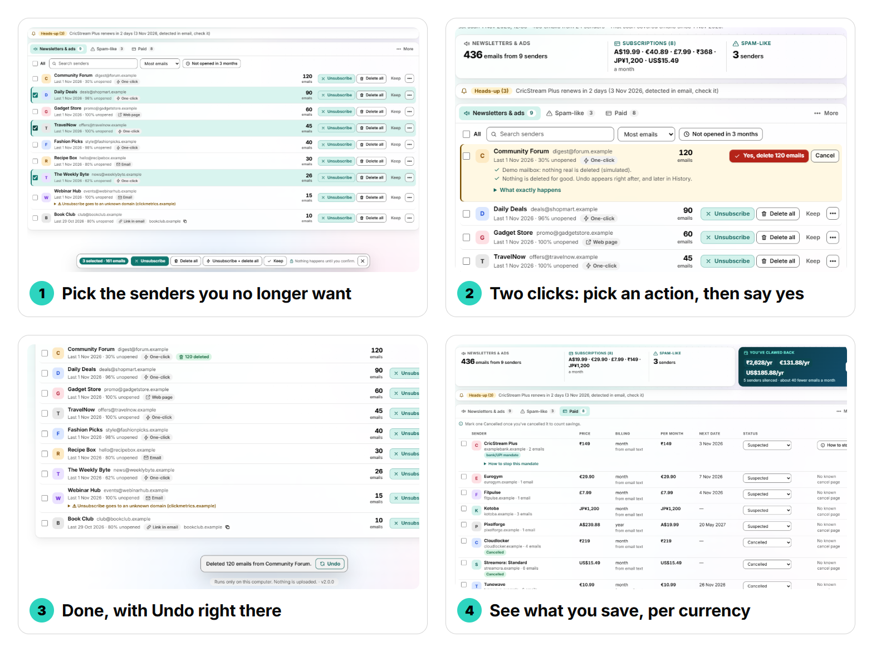
  </picture>
</p>

### The app at a glance

The local web app walks you through five steps shown at the top of every screen: **Connect, Scan,
Clean up, Confirm, Savings**. After a scan you land on the sender list: the most emails first, a
search box, a sort, and three tabs (*Newsletters & ads*, *Spam-like*, *Paid*). Important mail,
*Did it work?*, privacy requests and *History* sit under **More**.

| | |
|---|---|
| 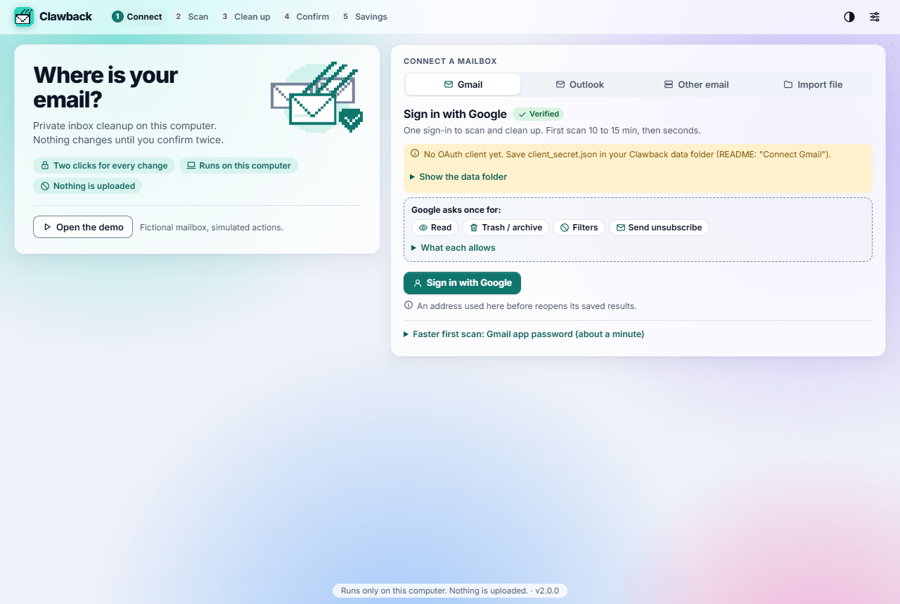 | 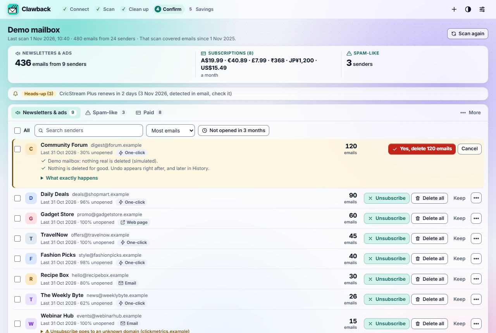 |
| **Connect**: Gmail, Outlook, other email (IMAP presets) or a file import, each with its test label; or the demo. | **Two clicks, in place**: the row's buttons become "Yes, delete 120 emails" and Cancel; Cancel has the focus. No pop-up. |
| 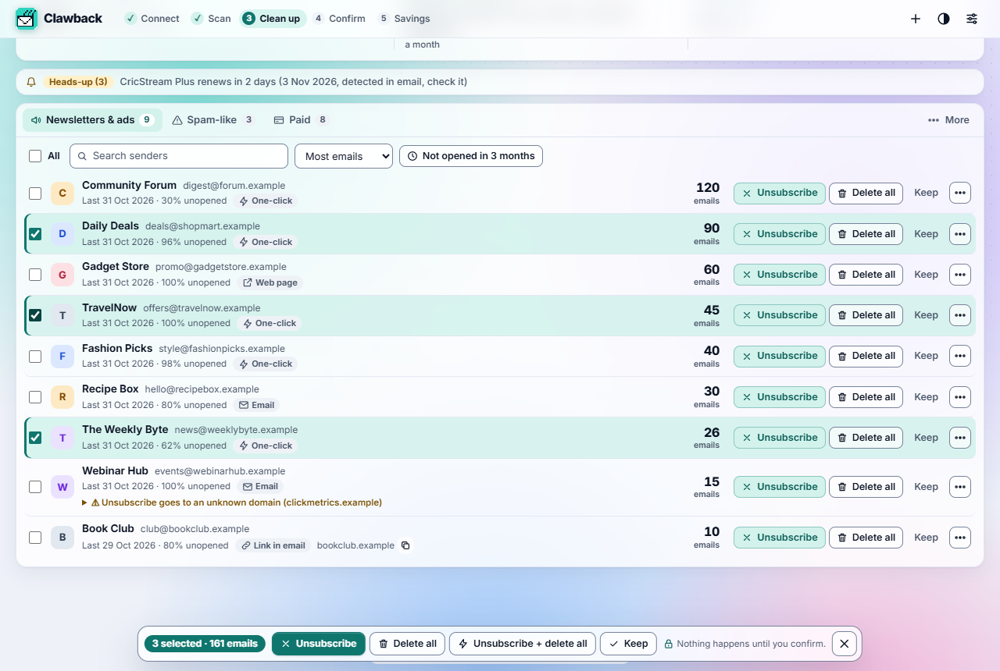 | 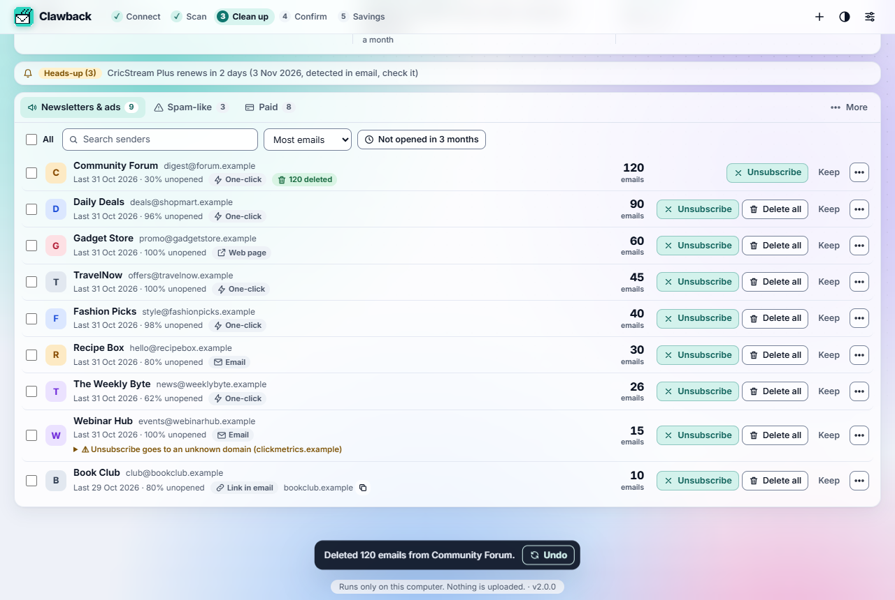 |
| **Pick senders**: tick several, the bar shows how many emails; nothing runs until you confirm. | **Undo right there**: Trash, Archive, Spam and filters can be taken back. |
| 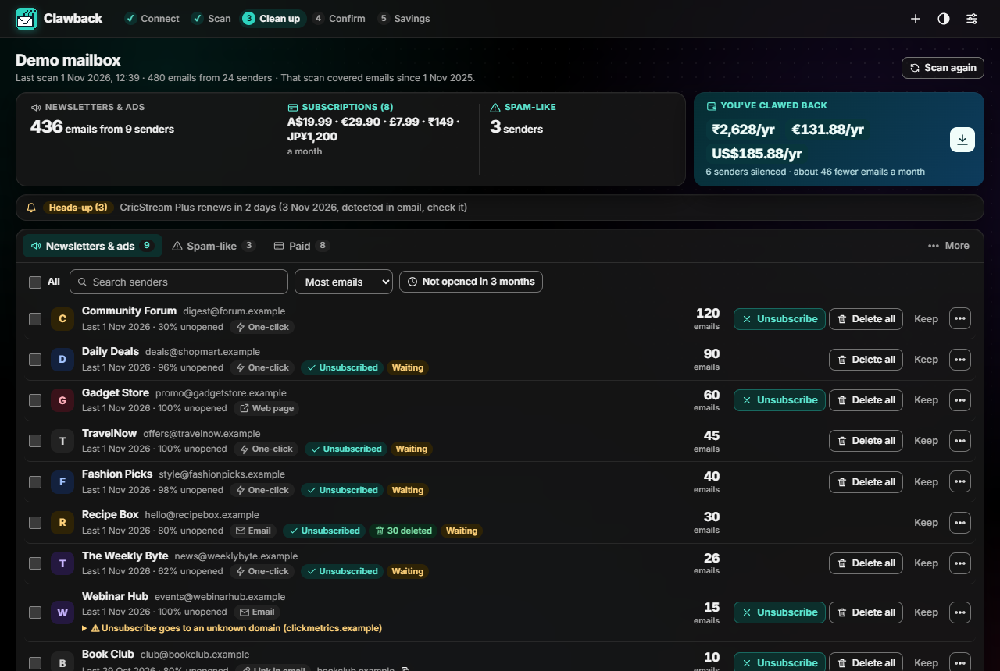 | 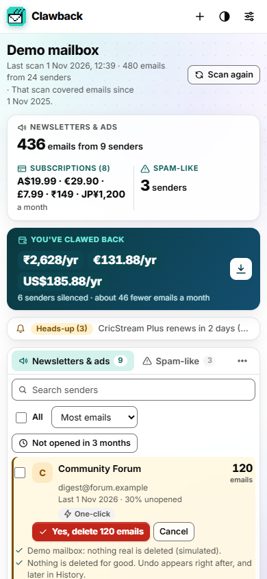 |
| **Black or white**: the black theme follows your system, or pick one in the header. | **Phone width**: the same two clicks in the row, both buttons in reach. |
| 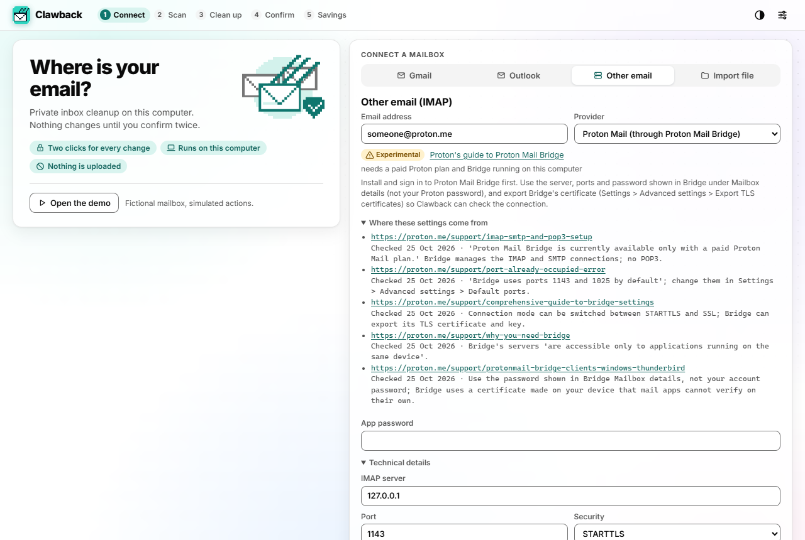 | 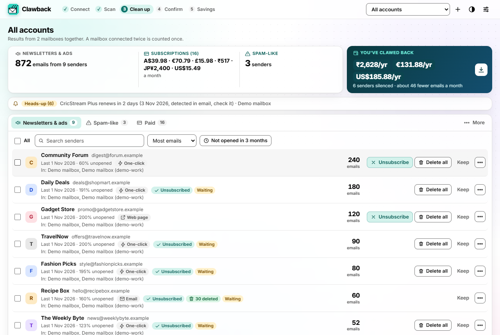 |
| **Other providers**: pick one and the servers, sign-in help and test label fill in. | **All accounts**: every scanned mailbox in one view; the same mailbox connected twice counts once. |

- Savings show one figure per currency, side by side, and are never added together.
- Scans show progress, can be paused or stopped, and list what they have found so far. If a scan
  fails, the error is shown at the top of your results with *Try again* (which repeats the same choice).
- You choose what each scan reads; see [Scan options](#scan-options).
- A soft, slowly moving colour background sits behind the panels. It is cheap (a tiny canvas
  repainted 8 times a second), stops while the tab is hidden and is a still picture if your system
  asks for reduced motion.
- Every screen works with the keyboard (visible focus, arrow keys between tabs), respects your
  system's reduced-motion setting and fits a phone-width window; the colour pairs, including text on
  the translucent panels over the brightest point of the moving background, are checked against
  WCAG AA contrast in both themes (white and black) by the test suite.
- The app loads nothing from other servers: its font (Inter, SIL Open Font License) and icons ship
  inside the package.

Prefer the terminal? Everything is in the CLI too:

```bash
clawback scan --demo                        # or: --import takeout.zip | --gmail | --user you@yahoo.com | --outlook --user you@outlook.com
clawback connectors                         # ways to connect, their labels, the IMAP presets
clawback senders                            # bulk senders: count, last received, unopened %, unsubscribe method
clawback unsubscribe deals@shopmart.example --dry-run   # a demo sender: shows the plan, contacts nobody
clawback unsubscribe deals@shopmart.example # prints the plan, then asks: Unsubscribe from Daily Deals? [y/N]
clawback delete deals@shopmart.example      # move all their emails to Trash (asks first; undo: clawback undo)
clawback unsubscribe-delete deals@shopmart.example   # both in one go, one question
clawback proof                              # did it work?
clawback savings                            # per currency, estimates
clawback --help
```

Every action shows its plan and then asks one question that names the action and the count; the
answer defaults to No, and no answer (or a closed input) does nothing. There is no flag that skips it
(the old `--yes` is accepted and ignored).

### Scan options

*Scan again* (and the first *Scan now* of a Gmail, IMAP or Outlook mailbox) asks what to read, with
a time estimate worked out from what earlier scans saved and each path's measured speed:

| Choice | What it reads | CLI |
|---|---|---|
| **Quick update** (recommended) | Only mail of the last 12 months that Clawback has not read yet: usually just what arrived since the last scan, so seconds. | `clawback scan ...` |
| **Fresh full scan** | Every email of the last 12 months again, as if for the first time. | `--full` |
| **From a date** | Every email since the date you pick, however long ago; emails read before are reused. | `--since 2025-03-01` (or `1m`, `3m`, `6m`, `1y`, `2y`, `all`) |
| **Your newest emails** | Only your newest N emails, however old (1 to 1,000,000); emails read before are reused. | `--last 500` |

- "Newest N" means the newest N on every source and on every scan: IMAP ranks all folders by arrival
  date, an imported export is read twice (dates first) because it is in no particular order, and
  emails an earlier scan read count towards N without being read again. Asking for the newest 500
  twice reads nothing new the second time.
- `--last` cannot be combined with `--since` or `--limit` (it already says what to read). `--limit N`
  is a safety cap on a date window: the newest N emails of it.
- A date in the future is refused; a date before email existed (before 1971) means all mail.
- The first scan of a mailbox offers *Standard scan* (the last 12 months), *From a date* or *Newest
  emails*. The demo and imported files are read whole and start straight away.
- After an update that sorts mail better, the next scan reads the chosen mail once more (the new rules
  need details Clawback never saves, such as Gmail's tabs); the picker and the running scan say so.
- The results say what the last scan covered ("your newest 500 emails", "emails since 1 Mar 2025"),
  and whether it was stopped early; results always include what earlier scans saved.

## Features

| Area | What you get |
|---|---|
| Bulk senders | Grouped by sender: email count, last received, unopened share (Gmail labels, IMAP flags, Takeout labels), unsubscribe method available, warnings. |
| Unsubscribe | RFC 8058 one-click HTTPS POST first; then `mailto:` (sent from your account only if you allow it); otherwise the page opens for you. With a Google or Microsoft sign-in also: delete (Trash) or archive their old mail, filter their future mail. |
| Spam-like senders | Separate tab. Clawback never clicks their unsubscribe links (that confirms your address is read). Block (Gmail filter or Outlook rule) or report spam instead (Google or Microsoft sign-in only). |
| Phishing checks | Flags DMARC/DKIM/SPF failures, look-alike (punycode) or raw-IP links, URL shorteners, display-name spoofing, unsubscribe links on unrelated domains. |
| Paid subscriptions | Receipts, renewals, trials, Apple/Google Play/Stripe-style receipts split per product, billing cycle from text or from receipt spacing, price history and price-rise alerts, renewal and trial reminders, verified cancel pages, "mark cancelled". |
| Regional money finders | India: UPI AutoPay, card e-mandate / standing-instruction and e-NACH alerts give the merchant, amount and next debit, with sourced steps to revoke in Google Pay, ICICI and Axis (others labelled general guidance). EU/UK: SEPA and Direct Debit notices. Card-network recurring-charge alerts anywhere. |
| Savings | Monthly, yearly and "so far" per currency for cancelled subscriptions; emails avoided per month for silenced senders; optional combined total only with your own dated rates. Shareable card with totals only (no names, no addresses). |
| Did it work? | Honoured / Waiting / Still sending per sender, timeline, "ignored your unsubscribe" list, confirmed escalation. |
| Privacy footprint | Every company that has your address, by volume. Draft data-deletion requests under India's DPDP Act 2023, the EU GDPR, UK GDPR or California's CCPA (drafts only; sending is confirmed twice). Not legal advice. |
| Housekeeping | Keep-list (never suggested or touched), activity log with undo, export/import of your local data, multiple mailboxes, white and black themes, keyboard navigation with visible focus, reduced motion respected, works on a phone-width window. |

## How Clawback compares

Star counts checked on 2026-10-24 with the GitHub API.

| | Clawback | [Inbox Zero](https://github.com/elie222/inbox-zero) (~12.8k★) | [labnol/unsubscribe-gmail](https://github.com/labnol/unsubscribe-gmail) (~1.57k★) | [justjake/gmail-unsubscribe](https://github.com/justjake/gmail-unsubscribe) (~301★) |
|---|---|---|---|---|
| What it is | Local Python app + CLI | AI email assistant; hosted service or self-host (Docker, Postgres, Redis) | Google Apps Script in your Google account, logs to a Sheet | Google Apps Script in a Google Sheet; unsubscribes from threads you label |
| Needs | Python; nothing else for Takeout import | Account or self-hosting stack | A Google account (Apps Script) | A Google account (Apps Script) |
| Bulk unsubscribe | Yes, two clicks (pick, then a Yes button naming the action and count) | Yes (Bulk Unsubscriber) | Yes | Yes, label-driven (one-click POST, mailto, or a GET on body links) |
| Spam-like senders handled separately | Yes (never unsubscribes from them) | Not that we found | Not that we found | Not that we found |
| Checks whether the sender stopped | Yes, with grace periods and timeline | Not that we found | Not that we found | No (success = request sent) |
| Paid subscriptions and savings | Yes, multi-currency, bank/UPI mandate alerts | Not its focus | Not that we found | Not that we found |
| Works without Gmail API access | Yes (Takeout/mbox/IMAP) | No | No | No |

Also worth knowing: [hush](https://github.com/justlinuxnoob/hush) (~20★) is a newer local desktop app
for Gmail that also unsubscribes and blocks senders that ignore you. Clawback differs by adding the
evidence-based verdicts, the money side, Takeout/IMAP support and regional modules. We would rather
you pick the right tool than oversell this one.

## Ways to connect, and how well each is tested

Every connector carries one of three labels, shown in the app, in `clawback connectors` and here:

- **Verified**: run against the real service. Today that is only reading Gmail through the Gmail API
  (and one real one-click unsubscribe).
- **Tested with fakes**: tested only against simulated servers; the settings come from the provider's
  own help page, but no real account has been connected yet.
- **Experimental**: written from the official documentation and tested only against simulated
  servers. Expect rough edges.

| Connector | Label | What it can do |
|---|---|---|
| Google Takeout or .mbox / .eml import | Tested with fakes | Scan; unsubscribe (one-click, or the page opens; `mailto:` opens in your mail app). **No delete, archive or block.** |
| Gmail: sign in with Google, reading | Verified | Scan. |
| Gmail: sign in with Google, cleanup (Trash, filters, unsubscribe email) | Tested with fakes | Unsubscribe (also by email), delete to Trash, archive, block, report spam, undo. |
| Gmail: fast scan with an app password | Tested with fakes | Scan; unsubscribe. **No delete, archive or block** (not built for IMAP yet). |
| Other providers over IMAP (presets below) | Tested with fakes | Scan; unsubscribe (by email too if you allow SMTP). **No delete, archive or block** (not built for IMAP yet). |
| Outlook.com and Microsoft 365: sign in with Microsoft | Experimental | Scan; unsubscribe (also by email); delete to Deleted Items, archive, block (an Outlook rule), report junk, undo. |
| Proton Mail through Proton Mail Bridge | Experimental | As other IMAP: scan and unsubscribe, no delete. |

**Deleting over IMAP (app passwords) is not implemented.** To delete, archive or block, connect Gmail
with *Sign in with Google* or Outlook with *Sign in with Microsoft*; on other connections the app shows
no Delete button and one line says why.

### IMAP presets

Pick your provider in the app (or just type your address: the domain picks the preset), or use
`clawback scan --user you@yahoo.com` (`--provider` to choose one). Every value below was read on the
provider's own page on 25 Oct 2026; the pages are linked, and `clawback connectors --sources` prints
what each one says.

| Provider | IMAP server | Sign-in | Label | Sources |
|---|---|---|---|---|
| Gmail | `imap.gmail.com:993` SSL | App password ([how](https://myaccount.google.com/apppasswords)) | Tested with fakes | [1](https://developers.google.com/workspace/gmail/imap/imap-smtp), [2](https://support.google.com/accounts/answer/185833), [3](https://support.google.com/mail/answer/7126229) |
| Outlook.com, Hotmail, Live | `outlook.office365.com:993` SSL | Passwords switched off on 16 Sep 2024: use **Sign in with Microsoft** | Experimental | [1](https://support.microsoft.com/en-us/office/pop-imap-and-smtp-settings-for-outlook-com-d088b986-291d-42b8-9564-9c414e2aa040), [2](https://support.microsoft.com/en-us/topic/c5d65390-9676-4763-b41f-d7986499a90d), [3](https://learn.microsoft.com/en-us/exchange/client-developer/legacy-protocols/how-to-authenticate-an-imap-pop-smtp-application-by-using-oauth) |
| Yahoo Mail | `imap.mail.yahoo.com:993` SSL | App password ([how](https://help.yahoo.com/kb/SLN15241.html)) | Tested with fakes | [1](https://help.yahoo.com/kb/SLN4075.html), [2](https://help.yahoo.com/kb/SLN15241.html) |
| iCloud Mail | `imap.mail.me.com:993` SSL | App password ([how](https://support.apple.com/en-us/102654)) | Tested with fakes | [1](https://support.apple.com/en-us/102525), [2](https://support.apple.com/en-us/102654) |
| AOL Mail | `imap.aol.com:993` SSL | App password ([how](https://help.aol.com/articles/create-and-manage-app-password)) | Tested with fakes | [1](https://help.aol.com/articles/how-do-i-use-other-email-applications-to-send-and-receive-my-aol-mail), [2](https://help.aol.com/articles/create-and-manage-app-password) |
| Zoho Mail (personal or free plan) | `imap.zoho.com:993` SSL | App password ([how](https://www.zoho.com/mail/help/adminconsole/two-factor-authentication.html)) | Tested with fakes | [1](https://www.zoho.com/mail/help/imap-access.html) |
| Zoho Mail (own domain, paid plan) | `imappro.zoho.com:993` SSL | App password ([how](https://www.zoho.com/mail/help/adminconsole/two-factor-authentication.html)) | Tested with fakes | [1](https://www.zoho.com/mail/help/imap-access.html) |
| Fastmail | `imap.fastmail.com:993` SSL | App password ([how](https://www.fastmail.help/hc/en-us/articles/360058752854-App-passwords)) | Tested with fakes | [1](https://www.fastmail.help/hc/en-us/articles/1500000278342-Server-names-and-ports), [2](https://www.fastmail.help/hc/en-us/articles/360058752854-App-passwords) |
| GMX (gmx.com) | `imap.gmx.com:993` SSL | App password ([how](https://support.gmx.com/security/2fa/application-specific-passwords.html)) | Tested with fakes | [1](https://support.gmx.com/pop-imap/imap/server.html), [2](https://support.gmx.com/pop-imap/toggle.html), [3](https://support.gmx.com/security/2fa/application-specific-passwords.html) |
| Yandex Mail | `imap.yandex.com:993` SSL | App password ([how](https://yandex.com/support/yandex-360/customers/mail/en/mail-clients/others)) | Tested with fakes | [1](https://yandex.com/support/yandex-360/customers/mail/en/mail-clients/others) |
| Proton Mail (through Proton Mail Bridge) | `127.0.0.1:1143` STARTTLS | Proton Mail Bridge (paid plan) and its Bridge password | Experimental | [1](https://proton.me/support/imap-smtp-and-pop3-setup), [2](https://proton.me/support/port-already-occupied-error), [3](https://proton.me/support/comprehensive-guide-to-bridge-settings), [4](https://proton.me/support/why-you-need-bridge), [5](https://proton.me/support/protonmail-bridge-clients-windows-thunderbird) |

- Folders are found from the server's own folder list (RFC 6154 special-use flags), so Gmail's
  "All Mail" or an Archive folder works in any account language; Spam, Trash, Sent and Drafts are
  never scanned. Type folder names under *Technical details* to override.
- The certificate is always checked. Proton Mail Bridge uses its own certificate: export it from
  Bridge and give Clawback the file.
- App passwords are held in memory only, never written to disk.
- Not covered: work mailboxes behind a company login, and providers' regional servers not listed above
  (choose *Other* and type the server).

## Connect Outlook.com, Hotmail, Live or Microsoft 365 (Experimental)

Microsoft switched off password and app-password sign-in for Outlook.com mailboxes on 16 September
2024, so Clawback signs in with Microsoft instead (OAuth 2.0 with PKCE, through Microsoft Graph).
Like Gmail, it needs an app registration of your own, free, about five minutes
([Microsoft's guide](https://learn.microsoft.com/en-us/entra/identity-platform/quickstart-register-app)):

1. Sign in at [entra.microsoft.com](https://entra.microsoft.com) with any Microsoft account and open
   **App registrations > New registration**.
2. Name it *Clawback*. Supported account types: **Any Entra ID tenant and personal Microsoft accounts**.
3. Redirect URI: platform **Mobile and desktop applications**, value `http://localhost`. Register.
4. Copy the **Application (client) ID** from the Overview page into Clawback
   (app: *Sign in with Microsoft*; CLI: `clawback scan --outlook --user you@outlook.com --client-id <id>`).

All four are asked for in **one sign-in**, so cleanup never stops to ask again (a sign-in saved by an
older version, read-only, asks once with **Sign in again to allow cleanup**):

| Graph permission | Used for |
|---|---|
| `Mail.Read` | Reading headers, and full text only for possible receipts. |
| `Mail.ReadWrite` | Moving the confirmed senders' mail to Deleted Items, Archive or Junk, and back. Clawback never deletes for good. |
| `Mail.Send` | Sending a confirmed `mailto:` unsubscribe or deletion request. |
| `MailboxSettings.ReadWrite` | Creating (and on undo deleting) one Outlook rule per sender you block. |

No client secret exists; tokens stay in `~/.clawback/tokens/`. Work and school accounts may need
their organisation's approval.

## All accounts

With two or more scanned accounts, choose **All accounts** at the top (CLI: `clawback senders
--account all`). The same Gmail connected twice (Gmail API and IMAP) is recognised as one mailbox, by
its address and by Gmail's shared message ids, and each email is counted once. The same newsletter in
two different mailboxes is added up and tagged with both. Savings stay per currency. An action on a
sender splits into one part per mailbox, confirmed with one Yes ("Yes, delete 240 emails"); each part
runs through the same checks as a single-account action.

## Connect Gmail

Gmail needs an OAuth client that belongs to you (Clawback has no server, so it cannot share one).
It is free and takes about five minutes:

1. Open [Google Cloud Console](https://console.cloud.google.com/), create a project (any name).
2. **APIs & Services → Library** → search **Gmail API** → **Enable**.
3. **APIs & Services → OAuth consent screen** (Google Auth Platform): choose **External**, fill in
   the app name and your email. Under **Audience → Test users**, add your Gmail address.
4. **Clients → Create client → Desktop app** → **Create** → **Download JSON**.
5. Save the file as `client_secret.json` in your Clawback data folder (shown in the app's
   Settings; by default `~/.clawback/`).
6. Under **Data Access → Add or remove scopes**, add `https://www.googleapis.com/auth/gmail.modify`
   and `https://www.googleapis.com/auth/gmail.settings.basic` (paste them under *Manually add scopes*),
   then **Update** and **Save**.
7. In the app, choose **Connect Gmail**. Before Google's page opens, the app lists what each
   permission is for. Google then shows one consent page for all of them; because the app is in
   testing mode you will see an "unverified app" notice for your own client. That is expected.

### Permissions (scopes) and why

| Scope | Google's class | Used for |
|---|---|---|
| `gmail.modify` | Restricted | Reading headers and bodies to find senders and receipts; moving the confirmed senders' mail to Trash, Archive or Spam and back; sending a confirmed `mailto:` unsubscribe or deletion request. It cannot delete mail for good. |
| `gmail.settings.basic` | Restricted | Creating (and, on undo, deleting) one Gmail filter per sender you block. |

Both are asked for **in one sign-in**, so you are never stopped later to sign in again before you can
delete. `gmail.modify` covers what `gmail.readonly` and `gmail.send` would, and Google's reference lists
it for `messages.get`, `messages.send`, `messages.batchModify` and `messages.trash` (reference pages
checked 2026-10-29, last updated 2026-04-15).
Clawback never asks for `https://mail.google.com/`, the only Gmail scope that allows deleting mail
permanently. A sign-in saved by an older version (read-only) still scans; the first time you clean up,
the app says so once and offers **Sign in again to allow cleanup**, which asks for both in one go.

Google classes even read-only Gmail access (`gmail.readonly`) as a **Restricted** scope
([Gmail API scopes](https://developers.google.com/workspace/gmail/api/auth/scopes), checked against the
page last updated 2026-09-10). A public app that asks for Restricted scopes must pass Google's
verification and a security assessment; Clawback has no such verified client, so each person uses their
own OAuth client in testing mode. Google says a client in testing mode with an
External user type gets sign-ins that expire after 7 days
([Using OAuth 2.0](https://developers.google.com/identity/protocols/oauth2), page last updated
2026-10-16), so expect to connect again about once a week. A Takeout import or an IMAP app password
avoids this.

You can revoke access any time at
[myaccount.google.com/permissions](https://myaccount.google.com/permissions). An expired or revoked
sign-in is detected and Clawback asks you to connect again.

## Safety: the double confirmation

1. **Choose (click 1).** Press a sender's Unsubscribe or Delete all (or an item in its menu), or tick
   senders and pick an action in the bar. Clawback builds a plan; nothing has happened yet. (Keep only
   adds the sender to your keep-list, which changes nothing in your mailbox.)
2. **Confirm (click 2).** In the same place, the buttons turn into **Yes, delete 37 emails** and
   **Cancel**: the Yes names the action and the count. One or two plain lines underneath say what will
   happen ("They go to Gmail Trash; you can restore them for 30 days", "This can't be undone from
   Clawback"), with each sender's method, contacted host, warnings and refusals folded under *What
   exactly happens*. No pop-up opens. The keyboard focus starts on **Cancel**, so Enter alone never
   acts; Escape, a click elsewhere or 8 seconds without a touch put the buttons back. The server runs the plan only when the count it gets back matches the plan,
   together with the plan's digest (so you confirm exactly what you saw), the 15-minute expiry and that
   the plan has not run before. There is no "select all and go", no default-yes and no auto mode, in
   the app or the CLI.
3. **Undo.** Delete means move to Trash (Outlook: Deleted Items), never a permanent delete. Right after
   an action a short message offers **Undo**; History keeps it for later.

Also: a dry-run switch (shows and logs, contacts nothing); a keep-list; one-click POSTs only over
HTTPS to public addresses, with no cookies or credentials and at most three safe redirects; links on
unrelated domains need an explicit "I checked this sender"; an activity log with undo (restore from
Trash, move back to Inbox, un-report spam, delete the filter Clawback created).

The local web server accepts requests only for `127.0.0.1` / `localhost` (DNS-rebinding protection),
requires a per-launch token on every state-changing request, refuses cross-origin requests and
serves a strict Content-Security-Policy.

## Privacy

- Mail is processed in memory. The local database (`~/.clawback/subscriptions.sqlite3`) stores
  metadata only: sender, subject, date, read state, detected prices. Message bodies are not stored.
- No telemetry and no crash reporting. The web app loads nothing from other servers (no CDN, no
  remote fonts or scripts); its font and icons are bundled in the package, and its
  Content-Security-Policy allows only the local server.
- Network traffic happens only when you confirm an action (an unsubscribe POST, an email you send)
  or connect to your own mail provider.
- Permissions are the smallest set that covers cleanup, asked for in one sign-in: Gmail uses
  `gmail.modify` and `gmail.settings.basic` (never the permanent-delete scope), which Google classes as
  **Restricted** because they can read all of your mail; Clawback uses them only on your computer, only
  for senders you confirm, with an OAuth client that belongs to you (see
  [Permissions](#permissions-scopes-and-why)). A Takeout import needs no permission at all, and can
  unsubscribe but not delete.
- OAuth tokens stay in `~/.clawback/tokens/`; app passwords are held in memory only, never written to disk.
- Delete everything by deleting the data folder. Export it first from History (under More) if you like.

## FAQ

**Why does the first Gmail scan take 10 to 15 minutes?** Google meters the Gmail API in quota
units, and one user may spend at most **6,000 units per minute** in a project. Reading one message's
headers (`messages.get` with `format=metadata`) costs **20 units**; reading it in full
(`format=full`) costs **60** ([Gmail API usage limits](https://developers.google.com/workspace/gmail/api/reference/quota),
figures checked against the page last updated 2026-10-16). So for a typical year of about 3,000
emails:

- headers alone: 3,000 × 20 = 60,000 units ÷ 6,000 per minute = **10 minutes**, whatever the app does;
- plus 60 units for each likely receipt Clawback reads in full (about 1 in 10 in our benchmark,
  another ~3 minutes);
- reading everything in full would be 3,000 × 60 = 180,000 units = 30 minutes, which is what the
  first version did.

Clawback reads headers for everything and full text only for billing candidates, and paces itself
just under the limit: our benchmark (`scripts/bench_scan.py`, simulated Gmail with real quota rules)
takes 13.1 minutes for 3,000 messages with no rate-limit errors. Bigger or busier mailboxes take
longer, smaller ones less.

**Next scans** only read mail that arrived since the last scan. Listing 3,000 already-read messages
costs about 30 units, so in the same benchmark a rescan took 1.4 seconds with nothing new and 2.5
seconds after a week of new mail (60 messages). These are simulated timings, not measurements on a
real account.

**Want the first scan fast too?** Use **Gmail fast scan** (IMAP with a Google
[app password](https://myaccount.google.com/apppasswords); `clawback scan --gmail-fast --user you@gmail.com`).
IMAP is not metered in API quota units, so 3,000 messages took about 8 seconds in the same
simulated benchmark (real speed depends on your connection and Google's servers). The trade-off:
an app password needs 2-Step Verification and can read and send all your mail until you revoke it;
Clawback only reads with it. A Takeout import needs no setup at all, but Google takes a while to
prepare the export.

**Will this find every subscription?** No tool can promise that. Clawback uses explainable
heuristics (see [docs/HEURISTICS.md](docs/HEURISTICS.md)); amounts can be assumed or ambiguous and
are labelled as such. Check your bank or card statements for exact figures.

**Does it cancel subscriptions for me?** No. It opens the verified cancellation page (or shows the
steps to revoke a bank/UPI mandate), and you mark it cancelled afterwards.

**Why not just click "unsubscribe" in every email?** For real spam, clicking confirms your address
is read. Clawback separates spam-like senders and offers Block or Report instead.

**My unsubscribe is "Waiting". Why?** Senders get a grace period: 2 days for one-click (Google's
sender guidelines recommend 48 hours) and 10 business days otherwise (the US CAN-SPAM limit).
Scan or import again later to see the verdict.

**Is the money total converted?** Only if you switch it on and type your own dated rates. Otherwise
each currency is shown separately.

**Which cancellation links are included?** About 30 global and regional pages, each checked by hand
and recorded with how and when ([data file](clawback/data/cancel_links.json)). Services whose
cancellation lives only inside a mobile app are not included rather than guessed.

**Is a DPDP/GDPR/CCPA letter legal advice?** No. The templates cite the provisions they rely on, but
whether a law applies depends on facts Clawback cannot check.

## Roadmap

Ideas being considered, in no fixed order. They describe direction, not promises or dates.

- Run the connectors labelled *Tested with fakes* and *Experimental* against real accounts, and update
  their labels only when they pass.
- More regional modules, and sourced, checked revoke steps for the banks and UPI apps that currently show
  general guidance (for example PhonePe, Paytm, HDFC, SBI and Kotak).
- Optional desktop notifications for trial ends and renewals you have confirmed.
- A signed desktop package, after a dependency, privacy and threat-model review.

Suggestions are welcome in [Discussions](https://github.com/sainisourabh1-oss/clawback/discussions).

## Contributing

Bug reports, regional modules, cancellation links with sources and fixes are all welcome. Start with
[CONTRIBUTING.md](CONTRIBUTING.md): it covers the development setup, the tests and smoke scripts, and the
hard rules (above all: no action without the two-click confirmation, and no personal data in the
repository). Please also read the [Code of Conduct](CODE_OF_CONDUCT.md).

```bash
git clone https://github.com/sainisourabh1-oss/clawback && cd clawback
python -m venv .venv && . .venv/bin/activate      # Windows: .venv\Scripts\activate
pip install -e ".[gmail,test]"
python -m pytest -q                                # synthetic fixtures only, no network
```

Questions: [SUPPORT.md](SUPPORT.md). Security problems: [SECURITY.md](SECURITY.md) (please report
privately). Changes per release: [CHANGELOG.md](CHANGELOG.md).

## Licence

[MIT](LICENSE). Vendor names in the cancellation-link list are used only to describe those services.
The bundled Inter font is © The Inter Project Authors, under the SIL Open Font License 1.1
(`clawback/web/static/fonts/OFL.txt`).
